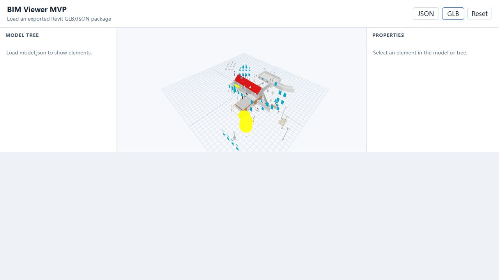

# BIM MVP 实际导出检查

检查对象：`C:\MyChatFloder\BimViewr\test` 中的 `model.glb` 与 `model.json`。
源模型：Revit 2020 自带的 `RAC_basic_sample_project.rvt`。
本次只做检查，没有修改源代码、插件 DLL 或原始导出文件。

## 实测数据

| 项目 | 数值 |
| --- | ---: |
| GLB 文件大小 | 20,955,824 字节 |
| JSON 文件大小 | 622,313 字节 |
| 构件 / GLB 节点 | 476 / 476 |
| 类别 | 28 |
| 唯一 BimId | 476 |
| GLB 节点与 JSON BimId 不匹配数量 | 0 |
| 几何 primitive 数量 | 19,640 |
| 三角形数量 | 238,281 |
| 材质数量 | 56 |
| 透明材质数量 | 0 |
| 含 NORMAL 属性的 primitive 数量 | 0 |

ID 值本身没有在本次导出中丢失；问题在于前后端字段命名不一致。
未与 Revit 内部构件总数进行比对，因此 476 不代表模型完整性已通过验证。

## P1：阻断功能或破坏模型正确性

### 1. JSON 大小写不一致，模型树崩溃，属性索引失效

- 实际 JSON 使用 `BimId / ElementId / Parameters`，树使用 `Id / Label / Kind / Children`。
- 前端读取 `bimId / elementId / parameters` 与 `id / label / kind / children`。
- 在浏览器加载真实 JSON 后复现 `Cannot read properties of undefined (reading 'length')`，指向 ModelTree 对 `node.children.length` 的读取。
- 构件索引使用 `element.bimId`，全部会得到 undefined，无法将拾取结果对应到属性。
- 先加载 JSON 导致组件异常后，再加载 GLB 还出现 `emitsOptions` 相关更新错误。
- 位置：`BIMExporter/Export/BimPackageExporter.cs:60`、`BIMExporter/Export/BimRecord.cs:13`、`BIMViewer/src/lib/bimPackage.ts:5`、`BIMViewer/src/components/ModelTree.vue:49`。
- 修复方向：明确统一输出协议；前端兼容现有 PascalCase 文件，并验证每条记录和树节点，而不仅检查顶层数组。

### 2. 族实例变换被重复应用，构件错位

- `GetInstanceGeometry()` 的结果已经位于实例所属模型坐标系，代码又乘了一次 `instance.Transform`。
- 已查阅本机 Revit 2020 `RevitAPI.xml` 中该方法的官方说明确认坐标语义。
- 单独加载 GLB 后，截图可见许多构件散落于建筑主体之外。代码错误足以导致此类错位，但尚未逐构件回到 Revit 测量。
- 位置：`BIMExporter/Export/BimPackageExporter.cs:93`。
- 修复方向：统一实例几何与坐标累计策略，使用包含平移、旋转、镜像及嵌套族的真实模型回归。旧 GLB 缺少修正所需的原始实例变换，不能仅靠前端可靠还原，应重新导出。

### 3. 非实体几何被静默跳过，无法保证导出完整

- 遍历只处理 GeometryInstance 和 Solid；直接返回的 Revit Mesh 被跳过，零体积实体也被跳过。
- 因此地形、网格导入等几何存在遗漏风险。本次数据没有“地形”类别，但没有 Revit 内部清单，不能仅据此断言具体遗漏数量。
- 位置：`BIMExporter/Export/BimPackageExporter.cs:98`。
- 修复方向：支持 Mesh，输出跳过原因和统计，并与源模型清单核对。

## P2：显示、性能及交互问题

### 4. 逐面生成 primitive，绘制开销过高

- 476 个构件被拆成 19,640 个 primitive；单个电气设备达到 668 个。
- 当前 GLTFLoader 会将这些片段转成大量 Mesh，前端还为每个 Mesh 克隆材质，显著增加对象和绘制开销。
- 这是片段数量实测，不是帧率或实际 GPU draw call 测量；实际绘制数量还受可见性和裁剪影响。
- 位置：`BIMExporter/Export/GlbBuilder.cs:71`、`BIMViewer/src/components/ModelViewer.vue:102`。
- 修复方向：在同一构件内按材质合并几何，保留构件 ID 边界，再考虑顶点去重及实例复用。

### 5. 材质透明度丢失，颜色与明暗表达不足

- 导出器把所有材质 alpha 写为 1，GLB 也未配置透明混合模式；玻璃等透明材质无法呈现原效果。
- RGB 直接除以 255 后写入 baseColorFactor，未处理颜色空间转换；还缺少纹理和显式顶点法线。
- 无法线不等于 GLB 无效，但会依赖加载器/渲染器的平面着色，影响曲面表现。
- 位置：`BIMExporter/Export/BimPackageExporter.cs:133`、`BIMExporter/Export/GlbBuilder.cs:254`。
- 修复方向：先支持基本颜色、透明度与法线，再明确纹理是否纳入下一阶段。

### 6. 页面高度分配错误，画布只占半屏

- 在 1280 × 720 窗口实测，画布为 640 × 320；底部约 329 像素空白。
- app-shell 固定三行 `auto auto 1fr`，错误提示由 v-if 移除后，workspace 落在第二个 auto 行，第三行仍占剩余空间。
- 小于 1100 像素时属性面板又被直接隐藏，没有替代入口。
- 位置：`BIMViewer/src/styles.css:37`、`:305`。
- 修复方向：让工作区明确填充剩余高度；窄屏提供可切换的树/属性面板。

### 7. 相机和可见性交互不完整

- 自制拖拽仅提供旋转，没有平移；拖动结束仍会触发 click 拾取，容易误选。
- 隔离不会自动聚焦；隐藏某构件后再隔离它，隐藏集合仍会让它不可见。
- 初始适配只按包围盒对角线设置距离，没有结合实际画布宽高比；错位构件还会扩大包围盒，让主体显得更小。
- 位置：`BIMViewer/src/components/ModelViewer.vue:123`、`:157`、`:179`；`BIMViewer/src/App.vue:54`。
- 修复方向：使用 OrbitControls，区分拖动与点击，提供全模型/选中构件聚焦，并明确隐藏与隔离优先级。

### 8. 更换模型的生命周期与校验不足

- GLB 和 JSON 可分别加载，不检查是否来自同一数据包。
- 连续加载时没有请求序号保护，旧请求可能覆盖新请求。
- 更换模型只释放 geometry，没有释放克隆材质；卸载组件也未完整清理模型资源。
- 位置：`BIMViewer/src/App.vue:18`、`:35`；`BIMViewer/src/components/ModelViewer.vue:81`、`:204`。
- 修复方向：成对加载并检查 ID 集合，防止过时回调更新场景，统一释放资源。

## 验证缺口与修复顺序

既有 4 个单元测试使用手写的小写字段样例，没有真实导出文件，因此测试通过不代表 Revit 到浏览器的闭环通过。

1. 修复数据协议、族实例坐标、非实体几何处理。
2. 修复画布布局、相机操作和隐藏/隔离行为。
3. 合并绘制片段，恢复透明度和基础着色。
4. 在 Revit 重新导出样例，以真实数据做浏览器回归；核对构件位置、属性、树、隐藏与隔离。

现有 JSON 可通过兼容解析恢复属性和树；现有 GLB 的坐标错误及遗漏几何需要重新导出解决。

